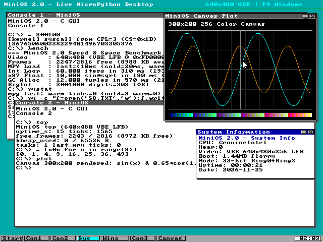
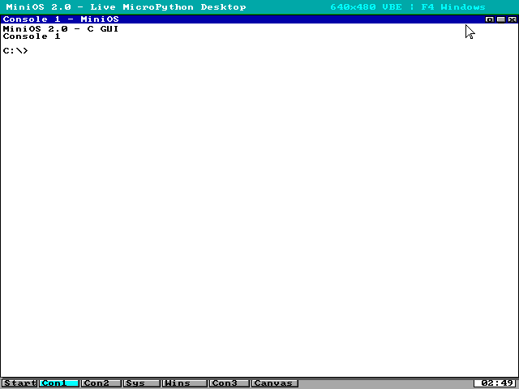
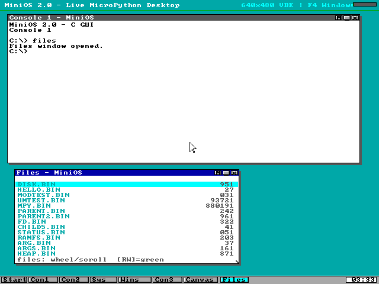
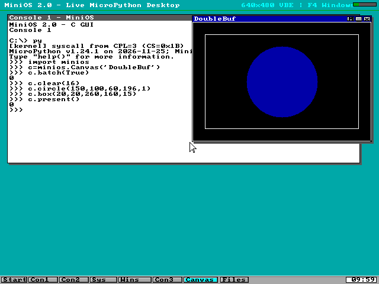

# MiniOS 2.0 — 1.44 MB AI Hobby OS

> [!WARNING]
> **This is a 100% AI-generated hobby/entertainment project.**
>
> It is **not** a production operating system, **not** security-audited, and
> **not** suitable for real work, private data, untrusted files, networking,
> or physical hardware. Run it only in a disposable QEMU VM.
>
> 这是一个纯 AI 生成的娱乐/演示项目，**不要用于真实用途、真实数据、生产环境或真实硬件**。
> 只能在一次性 QEMU 虚拟机里玩。

MiniOS 2.0 is a tiny x86 hobby desktop that boots from a single **1.44 MB
floppy image** (`1,474,560` bytes). It combines a C microkernel, a protected-mode
32-bit GUI, a Ring 3 MicroPython runtime, a few frozen Python tools, and a
CRC-checked RAMFS snapshot at the end of the floppy.

It exists to be entertaining and to make AI-assisted OS hacking visible.
Nothing here should be trusted with anything important.



## What is inside

- **1.44 MB single-floppy boot**: boot sector + stage2 + 128-sector C kernel +
  32 KB pack + MiniFS + SaveFS. No GRUB, no Linux host.
- **VBE 640×480×8bpp LFB desktop**, automatic VGA 320×200 fallback.
- **WM 2.0**: draggable windows, 8-way resize, minimize/maximize, snap,
  off-screen dragging, tile/cascade, frame-pool meter.
- **Three consoles** with 96-line scrollback, ANSI 16-color cells,
  per-console command buffers, histories, drag-select and clipboard.
- **Ring 3 MicroPython v1.24.1**, warm-cached in RAM (<10 ms re-entry),
  `open()/os/import`, `py SCRIPT.PY`.
- **Frozen tools**: `calc`, `top`, `demos`, `xxd`, `ed`, `futil`, `bench`,
  and an `art` demo.
- **Native `minios` Python module**: canvas, 256-color palette, batch/present,
  box/circle/blit, sysinfo, beep.
- **SaveFS**: `sync` / `os.sync()` writes a CRC32-checked RAMFS snapshot to
  LBA 2560–2819; boot restores it.
- **Files / Tasks / Memory** windows, GUI task kill, Files actions.







## Quick start (QEMU only)

Download/clone the repo and run the current C image:

```bash
qemu-system-i386 \
  -drive "file=MiniOS-C.img,if=floppy,format=raw,readonly=on" \
  -boot a -m 128 -vga std -rtc base=localtime
```

For SaveFS persistence, omit `readonly=on`, use a disposable copy, and run
`sync` inside the guest.

`MiniOS.img` is the older 16-bit real-mode experiment kept for history.

## Build

The checked-in image is playable as-is. Rebuilding requires:

- Python 3
- LLVM/clang, `ld.lld`, `objcopy`, NASM 2.16
- mpy-cross 1.24.1: `python -m pip install mpy-cross==1.24.1.post3`
- MicroPython v1.24.1 source at `tools/micropython/` (intentionally not
  committed; see `NOTICE`)

```bash
python c/build_c.py
```

The build must keep:

- image exactly `1,474,560` bytes
- `c/build/kernel.bin` under `65,536` bytes
- kernel BSS end under `0x70000`

## Documentation

- [Phase 1 roadmap](docs/python-os-roadmap.md)
- [Phase 2 roadmap](docs/minios-phase2-roadmap.md)
- [MicroPython ABI](docs/micropython-user-abi.md)
- [C kernel notes](c/README.md)

## License

MIT for the MiniOS code. See [LICENSE](LICENSE) and [NOTICE](NOTICE) for
third-party attribution, especially MicroPython (MIT).

## Status

Hobby project, constantly moving. AI-generated code can be wrong in creative
ways. Expect rough edges; do not deploy it anywhere real.
