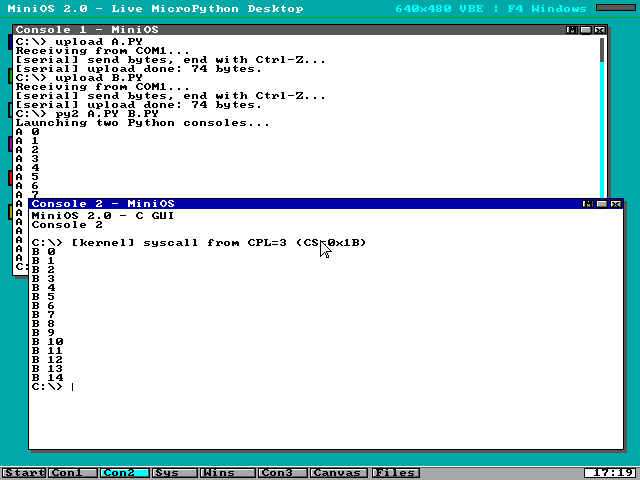
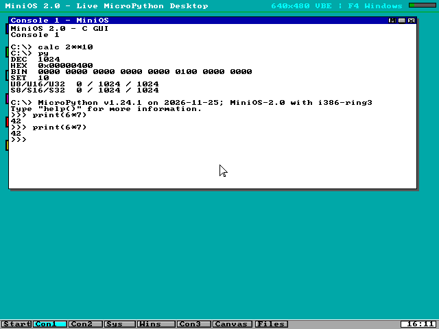

# MiniOS 2.0 — 1.44 MB AI Hobby OS

> [!WARNING]
> **This is a 100% AI-generated hobby/entertainment project.**
>
> It is **not** a production operating system, **not** security-audited, and
> **not** suitable for real work, private data, untrusted files, networking,
> or physical hardware. Run it only in a disposable QEMU VM.
>
> 这是一个纯 AI 生成的娱乐/演示项目，**不要用于真实用途、真实数据、生产环境或真实硬件**。
> 只能在一次性 QEMU 虚拟机里玩。

MiniOS 2.0 is a small x86 hobby desktop that boots from a single
**1.44 MB floppy image** (`1,474,560` bytes). It combines a 32-bit C kernel,
a VBE desktop, a persistent Task 0 scheduler, Ring 3 MicroPython processes,
and a snapshot filesystem at the end of the floppy.



## Current status

| Area | State |
|---|---|
| Phase 2, Stage 9–18 | Complete |
| Persistent Task 0 + kernel-stack `swtch` | Complete |
| Blocking `getchar` / `sleep` with concurrent Shell | Complete |
| Two/three concurrent Python consoles (`py2`, `py3`) | Complete prototype |
| Shared MPY read-only pages | Complete |
| A/B atomic SaveFS (MSV3) | Complete |
| Guest `selftest` + smoke test | Complete |
| Dynamic Canvas window table | Complete prototype |
| Optional ATA/FAT data disk | Not yet |
| Ring 3 Shell | Not yet; Task 0 plays the Shell for now |

## What is inside

- **Single-floppy boot**: boot sector + stage2 + 128 KB-capable kernel +
  program pack + MiniFS + A/B SaveFS.
- **Kernel at 3 MB**: loaded to a low staging area, copied to `0x300000`;
  the loader limit is now 128 KB instead of 64 KB.
- **VBE 640×480×8bpp desktop** with VGA 320×200 fallback.
- **Task 0 GUI/Shell kernel thread** and per-task kernel stacks.
- **Blocking Python input**: a REPL waiting for keys yields to Task 0, so the
  desktop and other consoles stay responsive.
- **Two and three concurrent Python instances**: `py2 A.PY B.PY` and
  `py3 A.PY B.PY C.PY`.
- **Shared MPY read-only pages**: text/rodata is mapped user-read-only and
  reference-counted; each Python task owns only its `.data/.bss` page, stack
  and heap.
- **WM**: draggable/resizable windows, minimize/maximize, snap, tile/cascade,
  frame-pool meter.
- **Frame-backed growable console table** (starts with four; `newcon` grows past eight) with ANSI colors, scrollback, history and per-console keyboard queues
  and clipboard.
- **Frozen Python tools**: `calc`, `top`, `demos`, `xxd`, `ed`, `futil`,
  `bench`, Paint, Plot, Snake and Life.
- **SaveFS MSV3 A/B**: two snapshot slots with generation selection,
  header CRC and per-file CRC. Legacy MSV1/MSV2 import remains.
- **Shell `selftest`**: opens/draws/presents/closes Canvas three times and
  emits `[selftest] PASS` on COM1.
- **Serial upload/download**: `upload NAME` + `tools/push.py`.
- **Kernel pipes**: four 4 KB pipes and `ls | grep BIN`.



## Disk layout

The checked-in image is exactly `1,474,560` bytes (2,880 × 512).

| Region | LBA / sectors | Notes |
|---|---|---|
| Boot sector | `0` | Loads kernel, pack and stage2 |
| Kernel | `1..256` | 128 KB staging limit; copied to `0x300000` |
| Program pack | `257..320` | 64 sectors, boot-loaded at `0x70000` |
| Stage 2 | `321` | VBE setup + protected-mode entry |
| MiniFS | `328..2559` | Read-only image files; current data ends well before SaveFS |
| SaveFS slot A | header `2560`, data `2561..2689` | 129 data sectors |
| SaveFS slot B | header `2690`, data `2691..2819` | 129 data sectors |
| Tail slack | `2820..2879` | Reserved |

A save writes the inactive slot, then commits its header. A torn write leaves
the previous slot valid. The first migration from an old single-slot snapshot
is the only non-atomic upgrade window.

## Quick start (QEMU only)

```bash
qemu-system-i386 \
  -drive "file=MiniOS-C.img,if=floppy,format=raw,readonly=on" \
  -boot a -m 128 -vga std -rtc base=localtime
```

For SaveFS persistence, omit `readonly=on`, use a disposable copy, and run
`sync` inside the guest. `MiniOS.img` is the old 16-bit experiment kept for
history.

Useful commands:

```text
help          calc 2**10       py            py SCRIPT.PY
py2 A.PY B.PY py3 A.PY B.PY    tasks         sync
ls            futil ls         selftest      metrics
```

## Build

The checked-in image is playable as-is. Rebuilding requires:

- Python 3
- LLVM/clang, `ld.lld`, `objcopy`, NASM 2.16
- `mpy-cross==1.24.1.post3`
- MicroPython v1.24.1 source at `tools/micropython/` (not committed; see
  `NOTICE`)

```bash
python c/build_c.py
python tools/smoke_test.py
```

Build guardrails:

- image exactly `1,474,560` bytes
- `c/build/kernel.bin` at most `131,072` bytes (256 sectors)
- kernel BSS end below `0x400000`
- MPY data page-aligned and `ro_size` present in the UMP1 header

Current measured sizes after Phase 3E Step 3A:

```text
kernel:  89,544 / 131,072 B
BSS end: 0x3a844e
MPY:     208,912 B
image:   1,474,560 B
```

## Verification

`tools/smoke_test.py` boots both video modes, triggers guest `selftest`, checks
COM1 `[selftest] PASS`, takes non-blank screendumps, and compares warmed frame
counts. The forced-320 path patches stage2 at LBA 321.

```text
SMOKE PASS: 640x480 + forced 320x200 boot, command, screenshot and warmed 0-leak checks
```

The leak check is a warmed steady-state comparison, not a cold-start absolute
baseline.

## Known limitations

- Task 0 is still a kernel C loop, not a Ring 3 Shell.
- `py2`/`py3` pre-create a batch; the Shell is responsive while they run, but
  there is no general `&`/background command yet.
- Shared MPY pages require the same image; a different image while tasks are
  alive is rejected.
- Window objects and Canvas state are assigned from a growable frame-backed table; Canvas windows are bound to a task PID and admitted only when free frames cover both ~62-page buffers. Python big-task slots remain capped at three.
- No ATA/FAT disk, no real-hardware support, no networking.
- SaveFS is atomic for new MSV3 snapshots, but legacy migration has one upgrade
  window.
- This is not a secure or production OS.

## Documentation

- [C kernel notes](c/README.md)
- [Phase 2 roadmap](docs/minios-phase2-roadmap.md) — historical Stage 9–18 log
- [MicroPython user ABI](docs/micropython-user-abi.md)
- [Phase 1 roadmap](docs/python-os-roadmap.md)

## License

MIT for the MiniOS code. See [LICENSE](LICENSE) and [NOTICE](NOTICE) for
third-party attribution, especially MicroPython (MIT).


