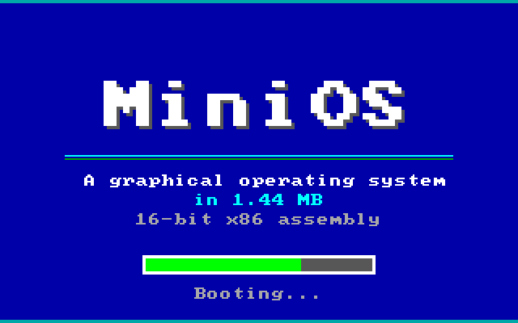
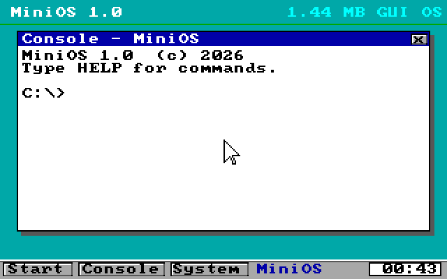
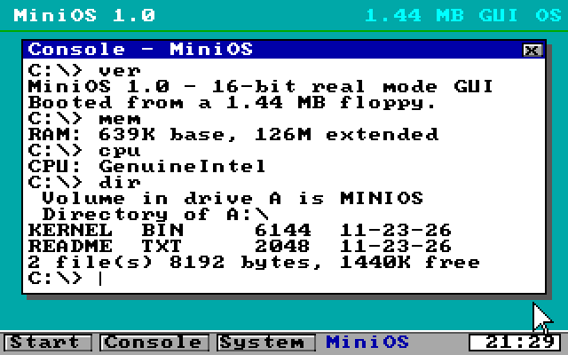
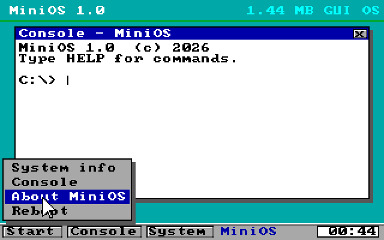
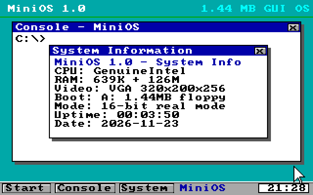
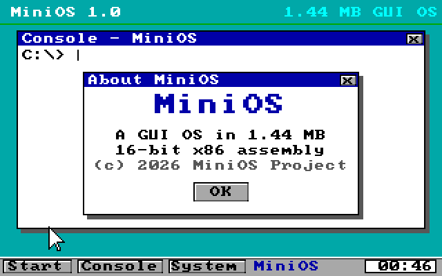

# MiniOS — 1.44 MB 图形操作系统

一个从零手写的 16 位 x86 实模式小操作系统：一个 512 字节引导扇区 + 约 8 KB 内核，
完整打包成 **1,474,560 字节（1.44 MB）** 的标准 80/2/18 软盘镜像，直接由 BIOS 引导，
启动后进入 VGA 320×200×256 图形界面，带鼠标、窗口、任务栏、开始菜单和内置命令 Shell。

> 没有 GRUB、没有 Linux 宿主、没有现成内核，镜像本身就是可启动系统。
> 这不是“在 1.44 MB 里塞一个 Linux”，而是从引导扇区开始的一整套自己的代码。

| 项目 | 大小 |
|---|---:|
| 引导扇区 `boot.bin` | 512 字节 |
| 内核 `kernel.bin` | 8,430 字节 |
| **最终镜像 `MiniOS.img`** | **1,474,560 字节 = 1.44 MB** |
| 镜像剩余空间 | 1,465,618 字节 |

SHA-256（`MiniOS.img`）：`8c753eff0135feaf9e5c2de8d1fecddd4d7b9ff83b0cf13faafa440a7120e864`



## 快速启动

需要 QEMU（建议 7.0 以上）。在 Windows 上直接运行：

```powershell
.\run.ps1
```

或者手动启动：

```powershell
qemu-system-i386 `
  -drive "file=MiniOS.img,if=floppy,format=raw,readonly=on" `
  -boot a -m 128 -rtc base=localtime
```

Linux / macOS：

```bash
qemu-system-i386 -drive file=MiniOS.img,if=floppy,format=raw,readonly=on \
  -boot a -m 128 -rtc base=localtime
```

QEMU 窗口只有 320×200 像素，可以把窗口拉大；鼠标被 QEMU 捕获后按 `Ctrl+Alt+G` 释放。

## 界面



- **VGA 320×200×256**，自建 16 色 DAC 调色板，所有绘制写入 64 KB 后备缓冲区后整帧拷贝，无闪烁。
- **窗口**：可拖动标题栏、点右上角 `x` 关闭；系统信息 / About 窗口可独立打开。
- **任务栏**：Start 菜单、Console、System、MiniOS 标识、实时时钟。
- **开始菜单**：System info / Console / About MiniOS / Reboot，支持鼠标悬停高亮。
- **鼠标**：PS/2 三字节数据包，IRQ12 中断驱动，12×18 自绘箭头光标，支持点击、拖动和关闭按钮。光标位图用 `.` 表示透明像素，只绘制 `X` 轮廓和 `W` 填充；尾端最后一排封口。鼠标移动只恢复/重绘 12×18 的光标格，不再每包整屏重绘。
- **键盘**：自写 IRQ1 扫描码驱动（US 布局、Shift 大小写），不依赖 BIOS `int 16h`；输入进入 Shell。
- **ROM 字体**：直接读取 VGA BIOS 的 8×8 点阵字体，并用整数倍缩放绘制启动页和 About 标题。
- **系统信息**：CPUID 读取 CPU 厂商，BIOS `int 15h E801/E88` 读取扩展内存，RTC 读取日期时间，BIOS tick 计算开机时长。
- **Shell**：14 行 × 35 列终端，支持滚动和 11 个命令。









## 操作

| 操作 | 功能 |
|---|---|
| 鼠标点击 `Start` | 打开/关闭开始菜单 |
| 点击任务栏 `Console` / `System` | 重新打开对应窗口 |
| 拖动窗口标题栏 | 移动窗口 |
| 点击窗口右上角 `x` | 关闭窗口 |
| `F1` | 打开 About 窗口 |
| `F2` | 打开 System Information 窗口 |
| `F3` | 重新打开 Console 窗口 |
| `Esc` | 依次关闭 About / System / 开始菜单 |
| `Enter`（About 打开时） | 关闭 About，相当于点击 OK |
| 直接键入 | 在 Console 中输入命令，`Backspace` 删除，`Enter` 执行 |

## 内置命令

| 命令 | 作用 |
|---|---|
| `help` | 显示命令列表 |
| `ver` | 版本与启动方式 |
| `time` | 当前时间（RTC） |
| `date` | 当前日期（RTC） |
| `mem` | 基本内存 / 扩展内存 |
| `cpu` | CPUID 厂商字符串 |
| `dir` | 演示用的软盘目录列表 |
| `cls` | 清屏 |
| `sysinfo` | 打开系统信息窗口 |
| `about` | 打开 About 窗口 |
| `reboot` | 通过键盘控制器复位并重新启动 |

> `dir` 显示的是内置演示文本，并非真正实现了 FAT12 文件系统；这个系统的“文件系统”不在本次目标内。

## 启动流程

1. BIOS 将镜像的第 1 个扇区加载到 `0000:7C00` 并执行。
2. 引导扇区读入紧随其后的 143 个扇区（71.5 KB）到 `0000:8000`。
3. 内核设置 VGA mode 13h、自定义调色板，绘制启动页，等待约 1.3 秒。
4. 初始化 PS/2 鼠标（IRQ12）、自写键盘驱动（IRQ1）、RTC、CPU/内存信息。
5. 进入主循环：处理键盘环形缓冲、鼠标中断；空闲 `hlt`，约 6 Hz 刷新时钟/闪烁，鼠标移动只重绘 12×18 光标格，点击/窗口变化才整帧重绘。
6. 渲染顺序：桌面 → 任务栏 → Console → System → About → 开始菜单 → 整帧 blit → 鼠标光标叠加。

### 内存布局

| 地址 | 用途 |
|---|---|
| `00000h–003FFh` | 中断向量表（自写 IRQ1 / IRQ12 入口） |
| `00400h–004FFh` | BIOS 数据区（0x413 基本内存、0x46C tick） |
| `07C00h` | 引导扇区 |
| `08000h` 起，约 8.4 KB | MiniOS 内核（代码 + 数据） |
| `20000h–2F9FFh` | 320×200 后备帧缓冲区（64,000 字节） |
| `A0000h` | VGA 显存（mode 13h） |
| `F0000h` | VGA BIOS ROM；`F000:FA6E` 的 8×8 字体 |

## 构建

需要 **NASM 2.16+** 和 Python 3.8+。当前工作区的 `tools/nasm-2.16.03/` 带了一份 Windows NASM；它属于本地工具链，不纳入 Git，其他环境请自行安装 NASM 或保留该目录。

```powershell
python build.py
```

输出：

- `build/boot.bin`：512 字节
- `build/kernel.bin`：8,430 字节
- `MiniOS.img`：精确 1,474,560 字节的 1.44 MB 软盘镜像

构建脚本会检查引导扇区大小、内核是否超过引导加载范围，以及最终镜像是否精确等于 1.44 MB。

## 源码结构

| 文件 | 内容 |
|---|---|
| `boot.asm` | 512 字节引导扇区，逐扇区 CHS 读盘，加载内核 |
| `kernel.asm` | 入口、VGA/调色板、启动页、PS/2 鼠标、键盘 IRQ、RTC、CPU/内存探测、主循环 |
| `graphics.asm` | 后备缓冲区、矩形填充/裁剪、ROM 字体渲染（1×/2×/4×）、光标、整帧 blit |
| `gui.asm` | 桌面、任务栏、开始菜单、三个窗口、窗口拖动/关闭、鼠标命中测试 |
| `shell.asm` | 终端缓冲、行编辑、命令解析和 11 个命令 |
| `data.asm` | 窗口/终端/鼠标变量、字符串、调色板、光标位图 |
| `keymap.inc` | US 键盘 Scancode Set 1 → ASCII 两张映射表 |
| `build.py` | NASM 汇编 + 镜像拼装 + 尺寸校验 |
| `run.ps1` | QEMU 启动脚本 |

## 技术说明与边界

- **真正的 16 位实模式**：没有进入保护模式，没有分页、多任务或虚拟内存；所有代码在 1 MB 内存内运行。
- **中断**：重新安装了 IRQ1（键盘）和 IRQ12（鼠标）中断门，并在 PIC 上解除对应屏蔽位。
- **键盘为什么不走 BIOS**：SeaBIOS 的 `int 16h` 会和鼠标数据抢同一个 8042 输出缓冲区，导致鼠标字节被当成字符输入；因此本系统自己解析 Scancode Set 1，只用 BIOS 读 RTC 和内存信息。
- **鼠标修复**：初始化 KBC 时在关中断区间内读取/写回配置字节，避免 BIOS 键盘中断抢走配置响应；这使得 IRQ12 能真正工作。
- **显示**：mode 13h 线性 320×200×256；不使用 VBE/线性帧缓冲，因此不依赖 VESA 扩展。
- **限制**：无声音、无网络、无磁盘写入、无 FAT12、无 USB 输入；主要面向 QEMU/BIOS 虚拟机。UEFI-only 固件需要开启 CSM 才能从软盘镜像引导。
- 1.44 MB 指**镜像大小**，其中真正代码只有约 8.9 KB，其余是软盘填充；这不是“8 KB 内核”的偷换概念。

## 已验证

- QEMU 11.0.1 / SeaBIOS，从 `MiniOS.img` 冷启动成功；
- 键盘键入 `help`、`ver`、`mem`、`cpu`、`dir`、`cls` 正常；
- PS/2 鼠标移动、开始菜单点击、窗口拖动正常；About 的 OK / X、Console 的 X、System 的 X 均已实测可关闭；
- 连续快速移动鼠标时无残影，空闲 CPU 约 8%；
- `F1` / `F2` / `F3` / `Esc` 正常；
- 最终镜像字节数精确为 `1,474,560`。

---

MiniOS 是学习和演示用的小系统：代码尽量小、依赖尽量少，但保持了完整可交互的图形桌面。


